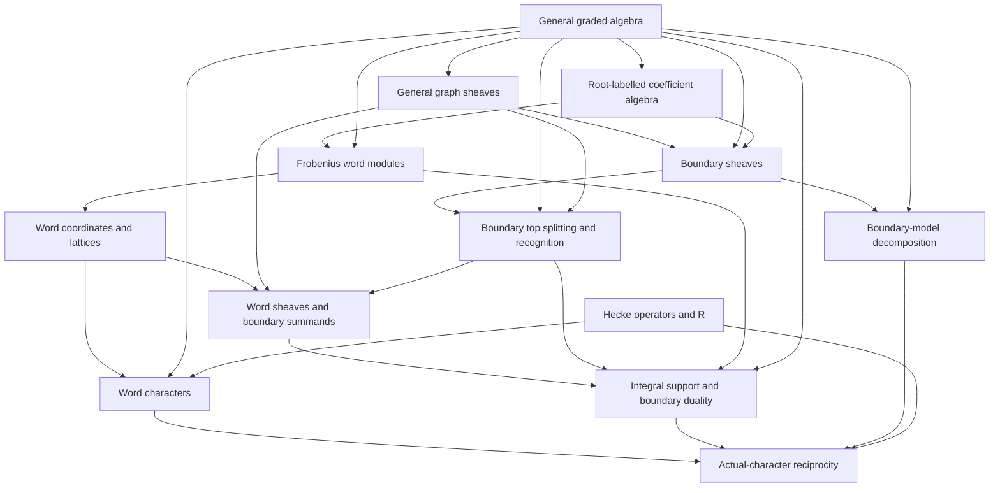
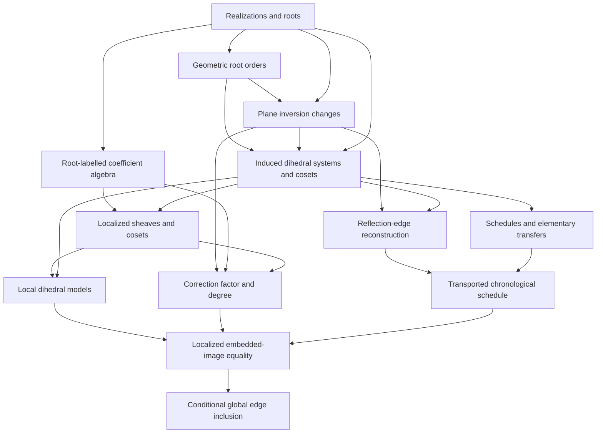
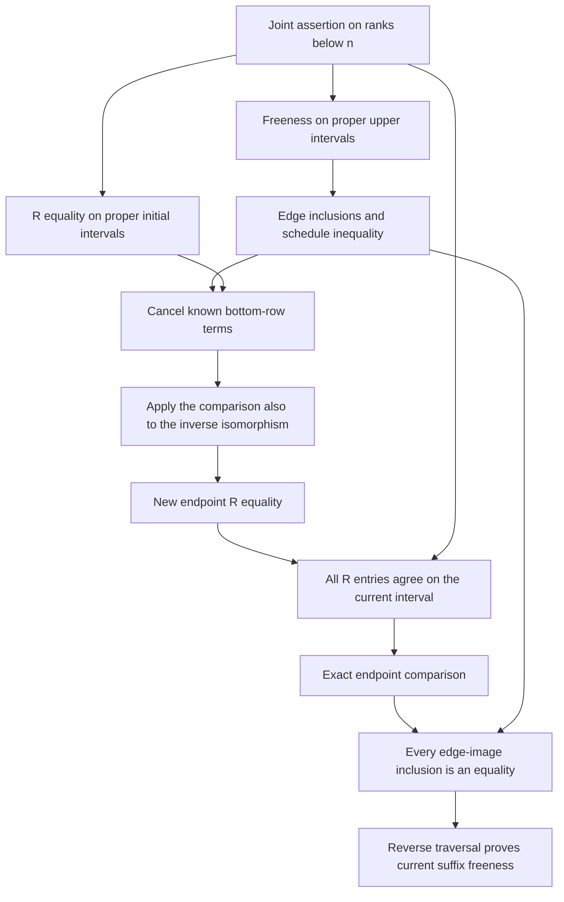

# Relationships between the proposed KB topics

Recorded: 2026-10-18. Status: organization approved on 2026-10-18; implementation in progress. Topic codes refer to the [full hierarchy](knowledge-base-hierarchy.md).

The mathematical hierarchy gives each concept a home. The relationships explain what the reader carries from that home into another construction or proof. Three kinds of relationship matter:

- **Definition:** one object uses another in its definition.
- **Construction:** earlier data produces a new object, map, or decomposition.
- **Proof:** an earlier theorem supplies a specified inference or hypothesis.

Suggested reading order is a separate layer. For example, a reader can learn general graph sheaves before the Tits extension. The Bruhat graph's polynomial labels require the realization when the general definitions are specialized.

The structured [relationship register](knowledge-base-relations.json) records the stages, their inputs, their outputs, and Lean anchors. The stage graph is a mathematical exposition graph; the anchors locate its interfaces in the local source.

## Relationships among the nine branches

**Coxeter combinatorics (C) supplies the common underlying intervals.** The realization branch R equips reflections with roots and actions; H equips intervals with R and P polynomials. These are different constructions on the same Coxeter data.

**Graded algebra (A) supplies a common language for the geometric constructions.** The realization produces the coefficient algebra and linear root labels. Graded modules, minimal covers, Hilbert values, and homogeneous bases then support both word modules W and sheaves S.

**Word modules (W) and boundary sheaves (S) meet through actual maps and decompositions.** Tensor words give explicit modules, pairings, and Hecke-controlled characters. Minimal extension gives boundary sheaves. Top splitting places a boundary object in the word sheaf, and the resulting projector transports the pairing through its adjoint image. Full model decomposition separately records all shifted boundary summands. Simultaneous stalk/costalk decomposition then yields reciprocity for the actual boundary character.

**Reflection geometry splits into two uses.** In O it yields dihedral systems, edge reconstruction, schedules, and path formulas. In L it determines the surviving graph after localization, the local structure models, and the correction factor for an edge.

**Hilbert comparison (I) joins these outputs.** The local inclusion of embedded images becomes an inequality between numerical states. Actual-character reciprocity describes the endpoints; the path formula identifies the transported transfer matrix. A simultaneous induction proves R-invariance and suffix-kernel freeness. Canonical polynomial rigidity then proves P-invariance, and finite-support models remove the finite-generator restriction.

## The two routes into the comparison

The following diagrams show selected interfaces from the relationship register. Each arrow carries a mathematical output; topic placement does not by itself create an arrow.

### From modules and sheaves to the endpoint vector

<!-- generated-character-diagram -->

<!-- /generated-character-diagram -->

There are two constructions to explain before their meeting point. A word module is obtained by successive tensor induction along reflection invariant subalgebras. A boundary sheaf is obtained by successive minimal covers of boundary images. The word sheaf meets the boundary construction through a top splitting, which supplies the projector used in the pairing argument. The separate full decomposition into shifted boundary models supplies the multiplicity polynomials for both character identities.

The word section pairing identifies the full outgoing kernel with the stalk dual, shifted by \(\ell(b)-\ell(x)\). Nonnegativity bounds each stalk-basis degree, so the kernel character is polynomial reflection of the stalk character. The Hecke-word identity computes that same polynomial as an R-convolution. Decomposition then supplies one multiplicity family for both stalks and kernels. Smaller-center reciprocity lifts to the ambient interval, and the top multiplicity is one; subtracting the two finite sums leaves precisely the new boundary identity. The source interfaces are [TitsSpace.bottKernelCharacter_rConvolution · CharacterReciprocity.lean:1134](https://github.com/jiajunma/combkl/blob/108243e05ed46235bf82dc30d4d90c794579776f/sources/openai-math/lean/OAI/RepresentationTheory/KazhdanLusztig/CharacterReciprocity.lean#L1134), [TitsSpace.bottCharacter_decomposition_both · CharacterReciprocity.lean:2019](https://github.com/jiajunma/combkl/blob/108243e05ed46235bf82dc30d4d90c794579776f/sources/openai-math/lean/OAI/RepresentationTheory/KazhdanLusztig/CharacterReciprocity.lean#L2019), [BruhatGraph.lowerCharacter_reciprocity_lift · CharacterReciprocity.lean:2174](https://github.com/jiajunma/combkl/blob/108243e05ed46235bf82dc30d4d90c794579776f/sources/openai-math/lean/OAI/RepresentationTheory/KazhdanLusztig/CharacterReciprocity.lean#L2174), [finite_character_cancellation · DyerPaths.lean:15](https://github.com/jiajunma/combkl/blob/108243e05ed46235bf82dc30d4d90c794579776f/sources/openai-math/lean/OAI/RepresentationTheory/KazhdanLusztig/DyerPaths.lean#L15), [BruhatGraph.stalkCharacter_reciprocity · DyerPaths.lean:62](https://github.com/jiajunma/combkl/blob/108243e05ed46235bf82dc30d4d90c794579776f/sources/openai-math/lean/OAI/RepresentationTheory/KazhdanLusztig/DyerPaths.lean#L62).

Write the resulting character as \(C\). It records homogeneous basis degrees of the actual boundary stalk. The argument uses its reciprocity and top value. The canonical polynomial \(P\) was constructed independently in H4 and is compared at the later rigidity stage.

For \(q=t^2\), the vector \(c_x^b(t)=t^{\ell(x)-\ell(b)}C_{x,b}(t^2)\) translates this polynomial identity into the normalized R-matrix identity. At \(0<t<1\), cancelling the coefficient Hilbert factor gives the empty-condition state \(c(t)\) and full-kernel state \(c(t^{-1})\). Upper-interval restriction preserves all outgoing conditions, so the same endpoint values pass to the schedule comparison. These are the unconditional endpoint formulas [BruhatGraph.normalized_emptyKernel_scaledStalk · TerminalKernels.lean:1273](https://github.com/jiajunma/combkl/blob/108243e05ed46235bf82dc30d4d90c794579776f/sources/openai-math/lean/OAI/RepresentationTheory/KazhdanLusztig/TerminalKernels.lean#L1273), [BruhatGraph.normalized_fullKernel_scaledStalk · TerminalKernels.lean:1284](https://github.com/jiajunma/combkl/blob/108243e05ed46235bf82dc30d4d90c794579776f/sources/openai-math/lean/OAI/RepresentationTheory/KazhdanLusztig/TerminalKernels.lean#L1284).

### From roots and intervals to edge comparison

The native dihedral models have a direct construction over the ambient polynomial ring. A simple-reflection involution balances the two length parities in a nontrivial lower interval; subtracting nested intervals supplies the external matching. The nondegenerate extended form then supplies orbit-spline factors with prescribed value and one or two zeros. Their product is a section with value equal to the supported outgoing-label product at its distinguished vertex and support below that vertex. Pairwise relative primality of those labels turns a remaining extension error into a multiple of that product. Removing a minimal vertex from the prescribed upper set, applying induction, and adding this multiple of the flow-down section proves flabbiness. The corresponding interfaces are [lower_parity_balance · SheafMorphisms.lean:252](https://github.com/jiajunma/combkl/blob/108243e05ed46235bf82dc30d4d90c794579776f/sources/openai-math/lean/OAI/RepresentationTheory/KazhdanLusztig/SheafMorphisms.lean#L252), [external_parity_card_le · SheafMorphisms.lean:288](https://github.com/jiajunma/combkl/blob/108243e05ed46235bf82dc30d4d90c794579776f/sources/openai-math/lean/OAI/RepresentationTheory/KazhdanLusztig/SheafMorphisms.lean#L288), [ReflectionPlane.formPair_surjective · ReflectionPlane.lean:16](https://github.com/jiajunma/combkl/blob/108243e05ed46235bf82dc30d4d90c794579776f/sources/openai-math/lean/OAI/RepresentationTheory/KazhdanLusztig/ReflectionPlane.lean#L16), [TitsSpace.orbitSpline_pair_factor · DihedralIntervals.lean:176](https://github.com/jiajunma/combkl/blob/108243e05ed46235bf82dc30d4d90c794579776f/sources/openai-math/lean/OAI/RepresentationTheory/KazhdanLusztig/DihedralIntervals.lean#L176), [Dihedral.interpolation_exists · DihedralIntervals.lean:251](https://github.com/jiajunma/combkl/blob/108243e05ed46235bf82dc30d4d90c794579776f/sources/openai-math/lean/OAI/RepresentationTheory/KazhdanLusztig/DihedralIntervals.lean#L251), [Dihedral.hasFlowDown · DihedralIntervals.lean:531](https://github.com/jiajunma/combkl/blob/108243e05ed46235bf82dc30d4d90c794579776f/sources/openai-math/lean/OAI/RepresentationTheory/KazhdanLusztig/DihedralIntervals.lean#L531), [MomentGraph.Sheaf.flowDown_flabby · DihedralIntervals.lean:372](https://github.com/jiajunma/combkl/blob/108243e05ed46235bf82dc30d4d90c794579776f/sources/openai-math/lean/OAI/RepresentationTheory/KazhdanLusztig/DihedralIntervals.lean#L372), [Dihedral.model_flabby · DihedralIntervals.lean:580](https://github.com/jiajunma/combkl/blob/108243e05ed46235bf82dc30d4d90c794579776f/sources/openai-math/lean/OAI/RepresentationTheory/KazhdanLusztig/DihedralIntervals.lean#L580).

The native models reach the actual finite relative coset graph through two explicit isomorphisms. Scalar extension maps a supported stalk tensor \(r\otimes f\) to \(r\eta(f)\), and an edge tensor to its quotient class. A common upper bound places the finite relative ideal in an intrinsic principal interval; order reflection and equality of the canonical ambient root labels identify its pulled-back model. The selected kernel at a vertex is the product of its selected supported labels times the stalk. Surjectivity of both restrictions carries that product to the corresponding scalar-image submodule in the actual edge module. Prime-label nondivisibility survives localization, supplying the pairwise relative primality in this product formula. These constructions are recorded by [MomentGraph.Sheaf.structureBaseChangeIso · MinimalExtensions.lean:1295](https://github.com/jiajunma/combkl/blob/108243e05ed46235bf82dc30d4d90c794579776f/sources/openai-math/lean/OAI/RepresentationTheory/KazhdanLusztig/MinimalExtensions.lean#L1295), [MomentGraph.Sheaf.structurePullbackIso · PlaneLocalization.lean:637](https://github.com/jiajunma/combkl/blob/108243e05ed46235bf82dc30d4d90c794579776f/sources/openai-math/lean/OAI/RepresentationTheory/KazhdanLusztig/PlaneLocalization.lean#L637), [TitsSpace.PlaneBasis.cosetModels · PlaneLocalization.lean:761](https://github.com/jiajunma/combkl/blob/108243e05ed46235bf82dc30d4d90c794579776f/sources/openai-math/lean/OAI/RepresentationTheory/KazhdanLusztig/PlaneLocalization.lean#L761), [MomentGraph.Sheaf.kernelProduct · PlaneLocalization.lean:795](https://github.com/jiajunma/combkl/blob/108243e05ed46235bf82dc30d4d90c794579776f/sources/openai-math/lean/OAI/RepresentationTheory/KazhdanLusztig/PlaneLocalization.lean#L795), [MomentGraph.Sheaf.structure_lower_image · PlaneLocalization.lean:867](https://github.com/jiajunma/combkl/blob/108243e05ed46235bf82dc30d4d90c794579776f/sources/openai-math/lean/OAI/RepresentationTheory/KazhdanLusztig/PlaneLocalization.lean#L867), [MomentGraph.Sheaf.structure_upper_image · PlaneLocalization.lean:878](https://github.com/jiajunma/combkl/blob/108243e05ed46235bf82dc30d4d90c794579776f/sources/openai-math/lean/OAI/RepresentationTheory/KazhdanLusztig/PlaneLocalization.lean#L878), [TitsSpace.PlaneBasis.coset_kernel_product · PlaneLocalization.lean:973](https://github.com/jiajunma/combkl/blob/108243e05ed46235bf82dc30d4d90c794579776f/sources/openai-math/lean/OAI/RepresentationTheory/KazhdanLusztig/PlaneLocalization.lean#L973).

The local decomposition uses the actual common outgoing image \(N\) identified by the old edge isomorphisms. Its existing model stalk \(P\) covers \(N\) with kernel inside \(\mathfrak mP\). A single lift \(g:B^x\to P\) is onto modulo \(\mathfrak m\), hence onto by Nakayama. A right inverse gives \(b\mapsto(gb,b-sgb)\), and the finite free kernel becomes copies of the model centered at \(x\). The induction invariant includes all edges with processed upper endpoints. It chooses a maximal unprocessed vertex, defines incoming edge maps by the new upper quotient, and verifies outgoing squares against the old edge maps. The interfaces are [LocalCover.lift_surjective · ModuleAlgebra.lean:165](https://github.com/jiajunma/combkl/blob/108243e05ed46235bf82dc30d4d90c794579776f/sources/openai-math/lean/OAI/RepresentationTheory/KazhdanLusztig/ModuleAlgebra.lean#L165), [LocalCover.exists_split_minimal_cover · ModuleAlgebra.lean:206](https://github.com/jiajunma/combkl/blob/108243e05ed46235bf82dc30d4d90c794579776f/sources/openai-math/lean/OAI/RepresentationTheory/KazhdanLusztig/ModuleAlgebra.lean#L206), [MomentGraph.Sheaf.AboveIso.map_stalk_image · GradedSheaves.lean:756](https://github.com/jiajunma/combkl/blob/108243e05ed46235bf82dc30d4d90c794579776f/sources/openai-math/lean/OAI/RepresentationTheory/KazhdanLusztig/GradedSheaves.lean#L756), [MomentGraph.Sheaf.AboveIso.extend_stalk · GradedSheaves.lean:766](https://github.com/jiajunma/combkl/blob/108243e05ed46235bf82dc30d4d90c794579776f/sources/openai-math/lean/OAI/RepresentationTheory/KazhdanLusztig/GradedSheaves.lean#L766), [MomentGraph.Sheaf.extend_modelSum · PlaneLocalization.lean:147](https://github.com/jiajunma/combkl/blob/108243e05ed46235bf82dc30d4d90c794579776f/sources/openai-math/lean/OAI/RepresentationTheory/KazhdanLusztig/PlaneLocalization.lean#L147), [MomentGraph.Sheaf.exists_modelSumIso · PlaneLocalization.lean:207](https://github.com/jiajunma/combkl/blob/108243e05ed46235bf82dc30d4d90c794579776f/sources/openai-math/lean/OAI/RepresentationTheory/KazhdanLusztig/PlaneLocalization.lean#L207).

The coefficient layer keeps three objects explicit: the original edge ring \(E_a=A/(\lambda(a))\), the plane ring \(R_P=A_{\mathfrak p_P}\), and the localized edge ring \(E_{P,a}=R_P/(\eta_P(\lambda(a)))\). The tensor-quotient map sends \(s\otimes[f]\) to \([s\eta_P(f)]\), identifying both reduction routes. A linear relation \(c=sa+rb\) with \(c\notin\mathbb Ra\) has \(r\ne0\); after killing \(a\), the image of \(r\) is the unit relating the two reduced labels. These interfaces are [MomentGraph.Sheaf.baseChangeQuotient · MinimalExtensions.lean:1239](https://github.com/jiajunma/combkl/blob/108243e05ed46235bf82dc30d4d90c794579776f/sources/openai-math/lean/OAI/RepresentationTheory/KazhdanLusztig/MinimalExtensions.lean#L1239), [PlaneReduction.associated_reduction · PlaneLocalization.lean:1281](https://github.com/jiajunma/combkl/blob/108243e05ed46235bf82dc30d4d90c794579776f/sources/openai-math/lean/OAI/RepresentationTheory/KazhdanLusztig/PlaneLocalization.lean#L1281), [BruhatGraph.EdgeRing · TerminalKernels.lean:516](https://github.com/jiajunma/combkl/blob/108243e05ed46235bf82dc30d4d90c794579776f/sources/openai-math/lean/OAI/RepresentationTheory/KazhdanLusztig/TerminalKernels.lean#L516), [TitsSpace.LocalizedEdgeRing · PlaneLocalization.lean:1312](https://github.com/jiajunma/combkl/blob/108243e05ed46235bf82dc30d4d90c794579776f/sources/openai-math/lean/OAI/RepresentationTheory/KazhdanLusztig/PlaneLocalization.lean#L1312), [TitsSpace.localizedReduction_associated · PlaneLocalization.lean:1330](https://github.com/jiajunma/combkl/blob/108243e05ed46235bf82dc30d4d90c794579776f/sources/openai-math/lean/OAI/RepresentationTheory/KazhdanLusztig/PlaneLocalization.lean#L1330).

The scalar-extension input is already available for general graph sheaves. Sections and selected outgoing kernels are kernels of their constraint maps. Finite tensor-product coordinates and flat exactness transport those kernels, while image transport follows by expanding tensor generators. The resulting equalities retain both edge images in one ambient module. Dihedral models enter after this algebraic transport, when the surviving coset sheaf is decomposed. The general interfaces are [MomentGraph.Sheaf.tensorSectionsEquiv · MinimalExtensions.lean:1157](https://github.com/jiajunma/combkl/blob/108243e05ed46235bf82dc30d4d90c794579776f/sources/openai-math/lean/OAI/RepresentationTheory/KazhdanLusztig/MinimalExtensions.lean#L1157), [FlatSubmodule.baseChange_ker · TerminalKernels.lean:279](https://github.com/jiajunma/combkl/blob/108243e05ed46235bf82dc30d4d90c794579776f/sources/openai-math/lean/OAI/RepresentationTheory/KazhdanLusztig/TerminalKernels.lean#L279), [FlatSubmodule.baseChange_map · TerminalKernels.lean:284](https://github.com/jiajunma/combkl/blob/108243e05ed46235bf82dc30d4d90c794579776f/sources/openai-math/lean/OAI/RepresentationTheory/KazhdanLusztig/TerminalKernels.lean#L284), [MomentGraph.Sheaf.baseChange_upwardKernel · TerminalKernels.lean:347](https://github.com/jiajunma/combkl/blob/108243e05ed46235bf82dc30d4d90c794579776f/sources/openai-math/lean/OAI/RepresentationTheory/KazhdanLusztig/TerminalKernels.lean#L347).

The coset restriction uses the finite lower ideal \(K=\{d\in D_P:da_0\le_Wb\}\), with the induced order. For a surviving ambient edge labelled by \(\tau\in D_P\), the relative target is \(\tau d\), since its ambient target is \((\tau d)a_0\). This explicit lift makes the image of a relative upper set closed under all surviving edges. The general pullback theorem then transfers flabbiness, and its fixed-vertex kernel counterpart transfers every selected outgoing kernel inside the same stalk. The source interfaces are [MomentGraph.Sheaf.pullback_flabby_live · MinimalExtensions.lean:1520](https://github.com/jiajunma/combkl/blob/108243e05ed46235bf82dc30d4d90c794579776f/sources/openai-math/lean/OAI/RepresentationTheory/KazhdanLusztig/MinimalExtensions.lean#L1520), [MomentGraph.Sheaf.pullback_kernel · MinimalExtensions.lean:1596](https://github.com/jiajunma/combkl/blob/108243e05ed46235bf82dc30d4d90c794579776f/sources/openai-math/lean/OAI/RepresentationTheory/KazhdanLusztig/MinimalExtensions.lean#L1596), [TitsSpace.PlaneBasis.coset_lift_live · PlaneLocalization.lean:497](https://github.com/jiajunma/combkl/blob/108243e05ed46235bf82dc30d4d90c794579776f/sources/openai-math/lean/OAI/RepresentationTheory/KazhdanLusztig/PlaneLocalization.lean#L497), [TitsSpace.PlaneBasis.localizedCoset_flabby · PlaneLocalization.lean:591](https://github.com/jiajunma/combkl/blob/108243e05ed46235bf82dc30d4d90c794579776f/sources/openai-math/lean/OAI/RepresentationTheory/KazhdanLusztig/PlaneLocalization.lean#L591), [TitsSpace.PlaneBasis.localizedCoset_kernel · TerminalKernels.lean:393](https://github.com/jiajunma/combkl/blob/108243e05ed46235bf82dc30d4d90c794579776f/sources/openai-math/lean/OAI/RepresentationTheory/KazhdanLusztig/TerminalKernels.lean#L393).

<!-- generated-local-diagram -->

<!-- /generated-local-diagram -->

The geometric construction has an internal order: generic slopes choose partner representatives; geometric plane weights measure changes of the ambient plane inversion count; plane-simple roots make that extra contribution vanish; conjugation then decreases the count and proves generation of the induced dihedral subgroup. The source steps are [TitsSpace.PlaneSimple.planeLength_step · Decomposition.lean:691](https://github.com/jiajunma/combkl/blob/108243e05ed46235bf82dc30d4d90c794579776f/sources/openai-math/lean/OAI/RepresentationTheory/KazhdanLusztig/Decomposition.lean#L691), [TitsSpace.PlaneSimple.planeLength_conj_drop · Decomposition.lean:807](https://github.com/jiajunma/combkl/blob/108243e05ed46235bf82dc30d4d90c794579776f/sources/openai-math/lean/OAI/RepresentationTheory/KazhdanLusztig/Decomposition.lean#L807), [TitsSpace.PlaneBasis.rootRef_mem_pairClosure · Decomposition.lean:833](https://github.com/jiajunma/combkl/blob/108243e05ed46235bf82dc30d4d90c794579776f/sources/openai-math/lean/OAI/RepresentationTheory/KazhdanLusztig/Decomposition.lean#L833).

The same root-plane geometry has three outputs:

1. It reconstructs reflection edges from the interval order, making edge transport possible.
2. It controls changes of root order and the path formula for transfer products.
3. It controls the local outgoing-label counts and the exponents of the correction factor.

The third output is used inside one edge module. Localizing at a plane makes labels outside that plane invertible; the corresponding edge modules vanish. The remaining component is described through a dihedral coset graph. The localized boundary sheaf decomposes into local structure models, where the two images can be calculated as products of labels.

The edge factor matches the difference of these products. Local equality of scaled images, denominator control, and membership in the free target yield the global inclusion. The source interfaces are [TitsSpace.PlaneBasis.localized_boundary_decomposition · TerminalKernels.lean:200](https://github.com/jiajunma/combkl/blob/108243e05ed46235bf82dc30d4d90c794579776f/sources/openai-math/lean/OAI/RepresentationTheory/KazhdanLusztig/TerminalKernels.lean#L200), [TitsSpace.PlaneBasis.localized_boundary_scaledImages · TerminalKernels.lean:245](https://github.com/jiajunma/combkl/blob/108243e05ed46235bf82dc30d4d90c794579776f/sources/openai-math/lean/OAI/RepresentationTheory/KazhdanLusztig/TerminalKernels.lean#L245), and [BruhatGraph.boundary_edge_image_le · TerminalKernels.lean:1045](https://github.com/jiajunma/combkl/blob/108243e05ed46235bf82dc30d4d90c794579776f/sources/openai-math/lean/OAI/RepresentationTheory/KazhdanLusztig/TerminalKernels.lean#L1045).

## The interfaces that topic pages should explain

| Passage | Mathematical input | Role in the proof |
|---|---|---|
| C → R | Simple generators, relations, reflections, and length | Construct the representation and interpret root signs in group-theoretic terms. |
| C → H | Reduced words and Bruhat recursion | Construct Hecke operators and the canonical polynomial families. |
| R → A1 | Extended root vectors and their action | Produce the coefficient algebra, its action, and nonzero linear labels. |
| A → W | Invariant algebras, tensor products, graded bases, and scalar transport | Define word modules and compute their graded pieces and pairings. |
| A5 + S2 → S4 | Minimal covers of boundary images | Build the boundary sheaf one vertex at a time. |
| W4–W6 + S1–S3 → S7 | Evaluation images and pair-projection maps | Turn a word module into a sheaf with explicit stalk and edge maps. |
| W2–W3 + S5–S7 → S8 | Perfect word pairings, integral support, and split maps | Construct pairings on boundary summands and identify costalk duals. |
| H5 + W7 + S5 + S8 → S9 | Word R-convolution and simultaneous character decomposition | Prove actual-character reciprocity by finite cancellation. |
| R5–R6 → O1 and O4 | Root signs, planes, and finite inversion sets | Construct slope orders and geometric plane-weight formulas. |
| O1 + O4 + R6 → O2 | Angular extremes, plane inversion changes, and root-subgroup membership | Prove generation by endpoint reflections and identify the induced Coxeter system and coset graph. |
| C4 + O4–O5 → O6 | Reconstructed reflection edges and rank-preserving order isomorphisms | Transport an edge schedule using interval order data. |
| H3 + O1–O3 + O7 → transported matrix | R-recursion and ordered path expansions | Identify transfer entries with normalized R-polynomials. |
| A1 + R6 + S2–S4 → L1–L4 | Plane ideals, labelled sheaves, and boundary properties | Reduce a localized sheaf to dihedral structure models. |
| O3–O4 + L3–L5 → L6 | Local outgoing counts and correction-factor exponents | Calculate equality of scaled model images. |
| A7 + L6 → L7 | Free-target membership and controlled denominators | Pass from local calculations to a global embedded-image inclusion. |
| A6 + L5–L7 → I1 | Hilbert exactness, a homogeneous factor, and image inclusion | Obtain the normalized one-edge inequality and its equality criterion. |
| O6–O7 + I1 → I2 | A complete edge schedule and monotone transfer operators | Accumulate the edge inequalities. |
| S8–S9 + O7 → I3 | Duality, actual-character reciprocity, and the R-matrix | Express and compare initial and terminal states. |
| A5–A7 + I2–I3 → I4 | Vanishing deficits and two presentations of one image | Recover all suffix-kernel freeness by reverse traversal. |
| C4 + I1–I4 → I5 | Strict rank decrease and conditional comparison/reconstruction | Prove R-invariance and new freeness together. |
| H4–H5 + I5 → I6 | A common R-matrix, reciprocity, and strict degree bounds | Prove equality of canonical P-polynomials. |
| C5 + I6 → I7 | Finite-support models preserving order and polynomials | Obtain the theorem for arbitrary Coxeter systems. |

The conjunctions in this table matter: a consumer usually needs several inputs. Each detailed topic page should identify all of them and state the applicable hypotheses.

## The central induction, with its rank dependencies exposed

Let \(\phi:[a,b]\simeq[a',b']\) be an interval order isomorphism and let \(n=\ell(b)-\ell(a)\). The simultaneous assertion contains:

1. Equality of the normalized R-polynomials at the two endpoint pairs.
2. Freeness of every remaining-condition kernel for every suffix of the transported chronological schedule.
3. The corresponding suffix freeness for the inverse isomorphism.

The predicate is [BruhatGraph.FreeSuffixes · SimultaneousInvariance.lean:118](https://github.com/jiajunma/combkl/blob/108243e05ed46235bf82dc30d4d90c794579776f/sources/openai-math/lean/OAI/RepresentationTheory/KazhdanLusztig/SimultaneousInvariance.lean#L118). The proof step is [BruhatGraph.rTilde_freeness_of_below · Invariance.lean:136](https://github.com/jiajunma/combkl/blob/108243e05ed46235bf82dc30d4d90c794579776f/sources/openai-math/lean/OAI/RepresentationTheory/KazhdanLusztig/Invariance.lean#L136), and strong rank induction is packaged by [BruhatGraph.rTilde_invariance_and_freeness · Invariance.lean:190](https://github.com/jiajunma/combkl/blob/108243e05ed46235bf82dc30d4d90c794579776f/sources/openai-math/lean/OAI/RepresentationTheory/KazhdanLusztig/Invariance.lean#L190).

The edges in this diagram have the following meanings:

- A proper upper interval starts at a vertex strictly above \(a\). Its smaller-rank freeness gives precisely the target kernel required at a scheduled edge. The restriction and cutoff identifications are [BruhatGraph.target_free_of_upper_suffixes · SimultaneousInvariance.lean:124](https://github.com/jiajunma/combkl/blob/108243e05ed46235bf82dc30d4d90c794579776f/sources/openai-math/lean/OAI/RepresentationTheory/KazhdanLusztig/SimultaneousInvariance.lean#L124).
- A proper initial interval ends at a vertex strictly below \(b\). Its R-equality supplies the known entries in the bottom row. Cancellation leaves the new endpoint entry. Applying the same comparison to \(\phi^{-1}\) gives the opposite inequality; see [BruhatGraph.rTilde_eq_of_smaller_data · Invariance.lean:95](https://github.com/jiajunma/combkl/blob/108243e05ed46235bf82dc30d4d90c794579776f/sources/openai-math/lean/OAI/RepresentationTheory/KazhdanLusztig/Invariance.lean#L95).
- Endpoint equality plus smaller-rank equalities gives the full R-matrix equality; see [rTilde_transport_all · Invariance.lean:33](https://github.com/jiajunma/combkl/blob/108243e05ed46235bf82dc30d4d90c794579776f/sources/openai-math/lean/OAI/RepresentationTheory/KazhdanLusztig/Invariance.lean#L33).
- That matrix equality and actual-character reciprocity make the endpoint comparison exact; see [BruhatGraph.actual_endpoint_of_rTilde_eq · SimultaneousInvariance.lean:278](https://github.com/jiajunma/combkl/blob/108243e05ed46235bf82dc30d4d90c794579776f/sources/openai-math/lean/OAI/RepresentationTheory/KazhdanLusztig/SimultaneousInvariance.lean#L278).
- Exactness propagates to each edge step, where Hilbert equality identifies the actual embedded images. The reverse traversal then obtains suffix freeness; see [BruhatGraph.schedule_kernels_free_of_endpoint_eq · SimultaneousInvariance.lean:217](https://github.com/jiajunma/combkl/blob/108243e05ed46235bf82dc30d4d90c794579776f/sources/openai-math/lean/OAI/RepresentationTheory/KazhdanLusztig/SimultaneousInvariance.lean#L217).

The graph is acyclic when ranks are shown: smaller-rank freeness enables the current comparison, and the current equality produces current-rank freeness. The reverse traversal itself starts with the no-condition kernel, which is the free stalk, and adds conditions back.

## Relationships that determine the organization

### Geometric plane weights and polynomial degrees have different consumers

The implemented hierarchy places the following results in separate entries:

- [TitsSpace.sum_planeWeight · ReflectionSchedules.lean:621](https://github.com/jiajunma/combkl/blob/108243e05ed46235bf82dc30d4d90c794579776f/sources/openai-math/lean/OAI/RepresentationTheory/KazhdanLusztig/ReflectionSchedules.lean#L621) counts geometric inversion changes:
  \[
  2\sum_{\Pi}k_{\Pi}=\ell(r_{\alpha}x)-\ell(x)-1.
  \]
- [TitsSpace.edgeFactor_degree_formula · ReflectionSchedules.lean:993](https://github.com/jiajunma/combkl/blob/108243e05ed46235bf82dc30d4d90c794579776f/sources/openai-math/lean/OAI/RepresentationTheory/KazhdanLusztig/ReflectionSchedules.lean#L993) turns that count into the degree of a polynomial correction factor.

The first belongs in O4. It uses inversion roots, the partner construction, and plane weights, and supplies the edge-reconstruction argument. The second belongs in L5. It additionally uses the coefficient quotient, reduced roots, nonvanishing, and homogeneity.

The geometric identity is recorded in `kl.geometry.plane_weight_sum`, and the polynomial degree calculation in `kl.paths.plane_degree`. O2 also uses the relative plane-count formula before the induced system is constructed.

### Sheaf construction, word realization, and duality are successive stages

S1–S4 define sheaves and construct boundary sheaves using graded covers. W constructs tensor words. S7 makes the word construction into a sheaf, S5 identifies its boundary summands, and S8 transfers pairings through the relevant maps.

The topic groups W and S consequently have relationships in both directions. At the level of individual constructions the order is:

\[
\text{general sheaves and word modules}
\longrightarrow \text{word sheaves and boundary summands}
\longrightarrow \text{boundary duality}
\longrightarrow \text{actual-character reciprocity}.
\]

A single arrow between whole branches would lose this information. The relationship register therefore uses stages within branches.

### Full kernels, partial kernels, and character recognition serve different roles

The full outgoing kernel is the costalk. Its duality and freeness are established by the pairing construction. A partial kernel imposes only the conditions in a schedule suffix. Freeness of all such kernels is one of the outputs of the simultaneous induction.

The property fields of `BoundarySheaf` explain the initial object. They should be presented before theorems about its costalks or schedule kernels, so the reader can see which properties are construction data and which are derived.

The local intersection branch has three inputs. Integral duality supplies \(I_x:(B^x)^*\to B^x\); boundary minimality puts its image in \(A_+B^x\); the inverse-duality degree gives the matrix degree \(d(x,b)-d_i-d_j\). A specified nonzero diagonal therefore gives \(2d_i<d(x,b)\) by the positive-ideal coordinate lemma. The separate character-identification condition supplies \(C=P\) as a polynomial equality, which can then be substituted into the two kernel endpoints. The source steps are [BruhatGraph.localIntersection · PositiveTransfer.lean:132](https://github.com/jiajunma/combkl/blob/108243e05ed46235bf82dc30d4d90c794579776f/sources/openai-math/lean/OAI/RepresentationTheory/KazhdanLusztig/PositiveTransfer.lean#L132), [BruhatGraph.localIntersection_diagonal_strict_degree · PositiveTransfer.lean:186](https://github.com/jiajunma/combkl/blob/108243e05ed46235bf82dc30d4d90c794579776f/sources/openai-math/lean/OAI/RepresentationTheory/KazhdanLusztig/PositiveTransfer.lean#L186), [BruhatGraph.StalkCharacterObligation · SheafMorphisms.lean:219](https://github.com/jiajunma/combkl/blob/108243e05ed46235bf82dc30d4d90c794579776f/sources/openai-math/lean/OAI/RepresentationTheory/KazhdanLusztig/SheafMorphisms.lean#L219), [BruhatGraph.normalized_fullKernel_of_duality_character · PositiveTransfer.lean:708](https://github.com/jiajunma/combkl/blob/108243e05ed46235bf82dc30d4d90c794579776f/sources/openai-math/lean/OAI/RepresentationTheory/KazhdanLusztig/PositiveTransfer.lean#L708).

The main comparison uses the actual character \(C\), its top normalization, and its reciprocity. The relation to canonical \(P\), and the source's character-identification condition, belongs in S10. In I6, canonical \(P\)-invariance follows from the common R-matrix and strict-degree rigidity. The source interfaces are [BruhatGraph.StalkCharacterObligation · SheafMorphisms.lean:219](https://github.com/jiajunma/combkl/blob/108243e05ed46235bf82dc30d4d90c794579776f/sources/openai-math/lean/OAI/RepresentationTheory/KazhdanLusztig/SheafMorphisms.lean#L219), [Comparison.eq_of_scaled_difference_reciprocal · SimultaneousInvariance.lean:328](https://github.com/jiajunma/combkl/blob/108243e05ed46235bf82dc30d4d90c794579776f/sources/openai-math/lean/OAI/RepresentationTheory/KazhdanLusztig/SimultaneousInvariance.lean#L328), and [BruhatGraph.klPolynomial_invariance_finite · Invariance.lean:427](https://github.com/jiajunma/combkl/blob/108243e05ed46235bf82dc30d4d90c794579776f/sources/openai-math/lean/OAI/RepresentationTheory/KazhdanLusztig/Invariance.lean#L427).

### Finite-support models return to the realization

C5 has its mathematical home in Coxeter combinatorics. Its complete transport theorem is a later stage: the local proof of the standard parabolic inclusion uses the faithful cotangent action to establish injectivity. Order transport then combines with canonical-polynomial transport. The relationship register therefore gives C5 a separate stage after the relevant parts of R and H; see [StandardParabolic.inclusion_injective · Tits.lean:1446](https://github.com/jiajunma/combkl/blob/108243e05ed46235bf82dc30d4d90c794579776f/sources/openai-math/lean/OAI/RepresentationTheory/KazhdanLusztig/Tits.lean#L1446) and [FiniteIntervalModel.kl_eq · Invariance.lean:517](https://github.com/jiajunma/combkl/blob/108243e05ed46235bf82dc30d4d90c794579776f/sources/openai-math/lean/OAI/RepresentationTheory/KazhdanLusztig/Invariance.lean#L517).

## Reading routes through the hierarchy

**To understand the invariance proof:** start with C3–C4 and H3–H4, then read the overview of I5. Develop A3–A6 and S1–S4 to understand the sheaf objects, W and S5–S9 to obtain the actual-character identity, and O/L to obtain the comparison theorem. Return to I1–I7 for the complete argument.

**To understand the geometric constructions:** follow R1–R6, A1, O1–O5, and L1–L5. The extended realization, induced dihedral systems, plane weights, and local models become one connected development.

**To understand the module and sheaf constructions:** start with A2–A7 and S1–S4. Follow W1–W7 and S5–S9 to see how explicit tensor coordinates produce abstract boundary duality and character reciprocity.

These are navigation routes through common entries. Definition links and prerequisite links let readers branch whenever they need a construction explained.

## Stage-level relationship register

Each row identifies a coherent construction or result, its immediate explanatory prerequisites, its output, and local Lean anchors. A conditional theorem retains its hypothesis in the row. The detailed induction above explains where those hypotheses are discharged.

<!-- generated-stage-register -->
| Stage and home | Immediate inputs | Output and Lean interfaces |
|---|---|---|
| **c — Coxeter intervals** (C1, C2, C3, C4) |  | Coxeter data, finite ranked intervals, and restriction to proper subintervals. [BruhatLE · Model.lean:18](https://github.com/jiajunma/combkl/blob/108243e05ed46235bf82dc30d4d90c794579776f/sources/openai-math/lean/OAI/RepresentationTheory/KazhdanLusztig/Model.lean#L18); [Interval · Model.lean:22](https://github.com/jiajunma/combkl/blob/108243e05ed46235bf82dc30d4d90c794579776f/sources/openai-math/lean/OAI/RepresentationTheory/KazhdanLusztig/Model.lean#L22); [rankDifference_subinterval_lt · Invariance.lean:20](https://github.com/jiajunma/combkl/blob/108243e05ed46235bf82dc30d4d90c794579776f/sources/openai-math/lean/OAI/RepresentationTheory/KazhdanLusztig/Invariance.lean#L20); [intervalIso_restrict · Dihedral.lean:19](https://github.com/jiajunma/combkl/blob/108243e05ed46235bf82dc30d4d90c794579776f/sources/openai-math/lean/OAI/RepresentationTheory/KazhdanLusztig/Dihedral.lean#L19); [intervalIso_rankDifference · CanonicalKL.lean:415](https://github.com/jiajunma/combkl/blob/108243e05ed46235bf82dc30d4d90c794579776f/sources/openai-math/lean/OAI/RepresentationTheory/KazhdanLusztig/CanonicalKL.lean#L415); [lower_parity_balance · SheafMorphisms.lean:252](https://github.com/jiajunma/combkl/blob/108243e05ed46235bf82dc30d4d90c794579776f/sources/openai-math/lean/OAI/RepresentationTheory/KazhdanLusztig/SheafMorphisms.lean#L252); [external_parity_card_le · SheafMorphisms.lean:288](https://github.com/jiajunma/combkl/blob/108243e05ed46235bf82dc30d4d90c794579776f/sources/openai-math/lean/OAI/RepresentationTheory/KazhdanLusztig/SheafMorphisms.lean#L288) |
| **r — Realizations and roots** (R1, R2, R3, R4, R5, R6) | c | Root vectors, extended action, reflection faithfulness, and root planes. [TitsSpace.form · Tits.lean:374](https://github.com/jiajunma/combkl/blob/108243e05ed46235bf82dc30d4d90c794579776f/sources/openai-math/lean/OAI/RepresentationTheory/KazhdanLusztig/Tits.lean#L374); [TitsSpace.extendedForm · Tits.lean:555](https://github.com/jiajunma/combkl/blob/108243e05ed46235bf82dc30d4d90c794579776f/sources/openai-math/lean/OAI/RepresentationTheory/KazhdanLusztig/Tits.lean#L555); [TitsSpace.reflectionFaithful · Tits.lean:1255](https://github.com/jiajunma/combkl/blob/108243e05ed46235bf82dc30d4d90c794579776f/sources/openai-math/lean/OAI/RepresentationTheory/KazhdanLusztig/Tits.lean#L1255); [ReflectionPlane.formPair_surjective · ReflectionPlane.lean:16](https://github.com/jiajunma/combkl/blob/108243e05ed46235bf82dc30d4d90c794579776f/sources/openai-math/lean/OAI/RepresentationTheory/KazhdanLusztig/ReflectionPlane.lean#L16); [TitsSpace.orbitSpline_pair_factor · DihedralIntervals.lean:176](https://github.com/jiajunma/combkl/blob/108243e05ed46235bf82dc30d4d90c794579776f/sources/openai-math/lean/OAI/RepresentationTheory/KazhdanLusztig/DihedralIntervals.lean#L176) |
| **a — General graded algebra** (A2, A3, A4, A5, A6, A7) |  | Graded modules, covers, homogeneous bases, coefficient/dual transport, Hilbert identities, projective presentations and scalar-denominator membership. [Graded.ModuleData · GradedModules.lean:1051](https://github.com/jiajunma/combkl/blob/108243e05ed46235bf82dc30d4d90c794579776f/sources/openai-math/lean/OAI/RepresentationTheory/KazhdanLusztig/GradedModules.lean#L1051); [Graded.ModuleData.MinimalCover · GradedModules.lean:1175](https://github.com/jiajunma/combkl/blob/108243e05ed46235bf82dc30d4d90c794579776f/sources/openai-math/lean/OAI/RepresentationTheory/KazhdanLusztig/GradedModules.lean#L1175); [Hilbert.hasSum_homogeneous_basis · HilbertSeries.lean:321](https://github.com/jiajunma/combkl/blob/108243e05ed46235bf82dc30d4d90c794579776f/sources/openai-math/lean/OAI/RepresentationTheory/KazhdanLusztig/HilbertSeries.lean#L321); [Hilbert.eq_of_value_eq · ModuleAlgebra.lean:549](https://github.com/jiajunma/combkl/blob/108243e05ed46235bf82dc30d4d90c794579776f/sources/openai-math/lean/OAI/RepresentationTheory/KazhdanLusztig/ModuleAlgebra.lean#L549); [CoefficientChange.dualEquiv · Support.lean:1802](https://github.com/jiajunma/combkl/blob/108243e05ed46235bf82dc30d4d90c794579776f/sources/openai-math/lean/OAI/RepresentationTheory/KazhdanLusztig/Support.lean#L1802); [ReverseFiltration.kernel_projective_of_presentation · ModuleAlgebra.lean:246](https://github.com/jiajunma/combkl/blob/108243e05ed46235bf82dc30d4d90c794579776f/sources/openai-math/lean/OAI/RepresentationTheory/KazhdanLusztig/ModuleAlgebra.lean#L246); [ProjectiveLattice.mem_of_prime_local_membership · IntegralPairings.lean:1904](https://github.com/jiajunma/combkl/blob/108243e05ed46235bf82dc30d4d90c794579776f/sources/openai-math/lean/OAI/RepresentationTheory/KazhdanLusztig/IntegralPairings.lean#L1904); [PairProjection.difference_annihilates · Decomposition.lean:213](https://github.com/jiajunma/combkl/blob/108243e05ed46235bf82dc30d4d90c794579776f/sources/openai-math/lean/OAI/RepresentationTheory/KazhdanLusztig/Decomposition.lean#L213); [FiniteFreeScalar.scalar_quotient_regular · BottSamelson.lean:924](https://github.com/jiajunma/combkl/blob/108243e05ed46235bf82dc30d4d90c794579776f/sources/openai-math/lean/OAI/RepresentationTheory/KazhdanLusztig/BottSamelson.lean#L924); [ProjectiveRange.projective_of_two_stage · IntegralPairings.lean:1349](https://github.com/jiajunma/combkl/blob/108243e05ed46235bf82dc30d4d90c794579776f/sources/openai-math/lean/OAI/RepresentationTheory/KazhdanLusztig/IntegralPairings.lean#L1349); [Graded.ModuleData.char_of_dual_equiv · Support.lean:784](https://github.com/jiajunma/combkl/blob/108243e05ed46235bf82dc30d4d90c794579776f/sources/openai-math/lean/OAI/RepresentationTheory/KazhdanLusztig/Support.lean#L784); [FlatSubmodule.baseChange_ker · TerminalKernels.lean:279](https://github.com/jiajunma/combkl/blob/108243e05ed46235bf82dc30d4d90c794579776f/sources/openai-math/lean/OAI/RepresentationTheory/KazhdanLusztig/TerminalKernels.lean#L279); [FlatSubmodule.baseChange_map · TerminalKernels.lean:284](https://github.com/jiajunma/combkl/blob/108243e05ed46235bf82dc30d4d90c794579776f/sources/openai-math/lean/OAI/RepresentationTheory/KazhdanLusztig/TerminalKernels.lean#L284); [ScalarQuotient.free_of_scalar_presentation · TerminalKernels.lean:595](https://github.com/jiajunma/combkl/blob/108243e05ed46235bf82dc30d4d90c794579776f/sources/openai-math/lean/OAI/RepresentationTheory/KazhdanLusztig/TerminalKernels.lean#L595); [MomentGraph.Sheaf.baseChangeQuotient · MinimalExtensions.lean:1239](https://github.com/jiajunma/combkl/blob/108243e05ed46235bf82dc30d4d90c794579776f/sources/openai-math/lean/OAI/RepresentationTheory/KazhdanLusztig/MinimalExtensions.lean#L1239); [PlaneReduction.associated_reduction · PlaneLocalization.lean:1281](https://github.com/jiajunma/combkl/blob/108243e05ed46235bf82dc30d4d90c794579776f/sources/openai-math/lean/OAI/RepresentationTheory/KazhdanLusztig/PlaneLocalization.lean#L1281) |
| **ra — Root-labelled coefficient algebra** (A1) | r, a | Symmetric/polynomial coefficients and linear root quotients. [TitsSpace.symmetricLabel · Support.lean:250](https://github.com/jiajunma/combkl/blob/108243e05ed46235bf82dc30d4d90c794579776f/sources/openai-math/lean/OAI/RepresentationTheory/KazhdanLusztig/Support.lean#L250); [BruhatGraph.polynomialRoot_prime · PlaneLocalization.lean:1372](https://github.com/jiajunma/combkl/blob/108243e05ed46235bf82dc30d4d90c794579776f/sources/openai-math/lean/OAI/RepresentationTheory/KazhdanLusztig/PlaneLocalization.lean#L1372); [SymmetricPlaneIdeal.quotientEquiv · PlaneLocalization.lean:56](https://github.com/jiajunma/combkl/blob/108243e05ed46235bf82dc30d4d90c794579776f/sources/openai-math/lean/OAI/RepresentationTheory/KazhdanLusztig/PlaneLocalization.lean#L56); [EdgeAlgebra.rootQuotientPolynomial · ReflectionSchedules.lean:871](https://github.com/jiajunma/combkl/blob/108243e05ed46235bf82dc30d4d90c794579776f/sources/openai-math/lean/OAI/RepresentationTheory/KazhdanLusztig/ReflectionSchedules.lean#L871) |
| **h — Hecke operators and R** (H1, H2, H3, H5) | c | Bar coefficients, R-recursion, and positive-word identities. [Hecke.rTilde · Hecke.lean:482](https://github.com/jiajunma/combkl/blob/108243e05ed46235bf82dc30d4d90c794579776f/sources/openai-math/lean/OAI/RepresentationTheory/KazhdanLusztig/Hecke.lean#L482); [HeckeQ.positiveWord_rValue · CharacterReciprocity.lean:997](https://github.com/jiajunma/combkl/blob/108243e05ed46235bf82dc30d4d90c794579776f/sources/openai-math/lean/OAI/RepresentationTheory/KazhdanLusztig/CharacterReciprocity.lean#L997) |
| **p — Canonical P and rigidity** (H4, H5) | h | Canonical KL family, reciprocal rigidity, and the constant P-family on abstract dihedral intervals. [NormalizedKL · Model.lean:55](https://github.com/jiajunma/combkl/blob/108243e05ed46235bf82dc30d4d90c794579776f/sources/openai-math/lean/OAI/RepresentationTheory/KazhdanLusztig/Model.lean#L55); [klPolynomial_eq_constructed · CanonicalKL.lean:286](https://github.com/jiajunma/combkl/blob/108243e05ed46235bf82dc30d4d90c794579776f/sources/openai-math/lean/OAI/RepresentationTheory/KazhdanLusztig/CanonicalKL.lean#L286); [Comparison.eq_of_scaled_difference_reciprocal · SimultaneousInvariance.lean:328](https://github.com/jiajunma/combkl/blob/108243e05ed46235bf82dc30d4d90c794579776f/sources/openai-math/lean/OAI/RepresentationTheory/KazhdanLusztig/SimultaneousInvariance.lean#L328); [Dihedral.klPolynomial_eq_one · Dihedral.lean:656](https://github.com/jiajunma/combkl/blob/108243e05ed46235bf82dc30d4d90c794579776f/sources/openai-math/lean/OAI/RepresentationTheory/KazhdanLusztig/Dihedral.lean#L656) |
| **s — General graph sheaves** (S1, S2, S3) | a | Stalk/edge maps, section constraints, selected kernels, finite-flat scalar extension and graded morphism extension. [MomentGraph.OrderedGraph · Sheaves.lean:21](https://github.com/jiajunma/combkl/blob/108243e05ed46235bf82dc30d4d90c794579776f/sources/openai-math/lean/OAI/RepresentationTheory/KazhdanLusztig/Sheaves.lean#L21); [MomentGraph.Sheaf · Sheaves.lean:28](https://github.com/jiajunma/combkl/blob/108243e05ed46235bf82dc30d4d90c794579776f/sources/openai-math/lean/OAI/RepresentationTheory/KazhdanLusztig/Sheaves.lean#L28); [MomentGraph.GradedSheaf · GradedSheaves.lean:20](https://github.com/jiajunma/combkl/blob/108243e05ed46235bf82dc30d4d90c794579776f/sources/openai-math/lean/OAI/RepresentationTheory/KazhdanLusztig/GradedSheaves.lean#L20); [MomentGraph.Sheaf.constraint · MinimalExtensions.lean:1031](https://github.com/jiajunma/combkl/blob/108243e05ed46235bf82dc30d4d90c794579776f/sources/openai-math/lean/OAI/RepresentationTheory/KazhdanLusztig/MinimalExtensions.lean#L1031); [MomentGraph.Sheaf.tensorSectionsEquiv · MinimalExtensions.lean:1157](https://github.com/jiajunma/combkl/blob/108243e05ed46235bf82dc30d4d90c794579776f/sources/openai-math/lean/OAI/RepresentationTheory/KazhdanLusztig/MinimalExtensions.lean#L1157); [MomentGraph.GradedSheaf.OnHom.exists_extension · SheafMorphisms.lean:834](https://github.com/jiajunma/combkl/blob/108243e05ed46235bf82dc30d4d90c794579776f/sources/openai-math/lean/OAI/RepresentationTheory/KazhdanLusztig/SheafMorphisms.lean#L834); [MomentGraph.Sheaf.pullback_flabby_live · MinimalExtensions.lean:1520](https://github.com/jiajunma/combkl/blob/108243e05ed46235bf82dc30d4d90c794579776f/sources/openai-math/lean/OAI/RepresentationTheory/KazhdanLusztig/MinimalExtensions.lean#L1520); [MomentGraph.Sheaf.pullback_kernel · MinimalExtensions.lean:1596](https://github.com/jiajunma/combkl/blob/108243e05ed46235bf82dc30d4d90c794579776f/sources/openai-math/lean/OAI/RepresentationTheory/KazhdanLusztig/MinimalExtensions.lean#L1596) |
| **sb — Boundary sheaves** (S4) | s, a, c, ra | Minimal-cover construction of the actual boundary object and its restrictions. [MomentGraph.exists_boundarySheaf · GradedSheaves.lean:1238](https://github.com/jiajunma/combkl/blob/108243e05ed46235bf82dc30d4d90c794579776f/sources/openai-math/lean/OAI/RepresentationTheory/KazhdanLusztig/GradedSheaves.lean#L1238); [BruhatGraph.boundarySheaf · SheafMorphisms.lean:202](https://github.com/jiajunma/combkl/blob/108243e05ed46235bf82dc30d4d90c794579776f/sources/openai-math/lean/OAI/RepresentationTheory/KazhdanLusztig/SheafMorphisms.lean#L202) |
| **ss — Boundary top splitting and recognition** (S5) | sb, a, s | A normalized top splitting extends to a boundary summand; primitive top data recognize an isomorphic boundary object. [MomentGraph.BoundarySheaf.splitIn_of_top_split · SheafMorphisms.lean:1380](https://github.com/jiajunma/combkl/blob/108243e05ed46235bf82dc30d4d90c794579776f/sources/openai-math/lean/OAI/RepresentationTheory/KazhdanLusztig/SheafMorphisms.lean#L1380); [MomentGraph.BoundarySheaf.iso_of_primitive_top_split · CharacterReciprocity.lean:1176](https://github.com/jiajunma/combkl/blob/108243e05ed46235bf82dc30d4d90c794579776f/sources/openai-math/lean/OAI/RepresentationTheory/KazhdanLusztig/CharacterReciprocity.lean#L1176) |
| **sd — Boundary-model decomposition** (S5) | sb, a | Finite downward construction of a graded model sum, retaining every restriction map and recording nonnegative shifts. [Graded.ModuleData.exists_minimalCover_split · SheafMorphisms.lean:1427](https://github.com/jiajunma/combkl/blob/108243e05ed46235bf82dc30d4d90c794579776f/sources/openai-math/lean/OAI/RepresentationTheory/KazhdanLusztig/SheafMorphisms.lean#L1427); [MomentGraph.GradedSheaf.exists_modelSumIso · SheafMorphisms.lean:1642](https://github.com/jiajunma/combkl/blob/108243e05ed46235bf82dc30d4d90c794579776f/sources/openai-math/lean/OAI/RepresentationTheory/KazhdanLusztig/SheafMorphisms.lean#L1642) |
| **w — Frobenius word modules** (W1, W2, W3) | ra, a | Iterated tensor modules, homogeneous bases, and perfect word pairings. [ReflectionFrobenius.coordinates · Decomposition.lean:1504](https://github.com/jiajunma/combkl/blob/108243e05ed46235bf82dc30d4d90c794579776f/sources/openai-math/lean/OAI/RepresentationTheory/KazhdanLusztig/Decomposition.lean#L1504); [FrobeniusDuality.restrictionEquiv · Frobenius.lean:168](https://github.com/jiajunma/combkl/blob/108243e05ed46235bf82dc30d4d90c794579776f/sources/openai-math/lean/OAI/RepresentationTheory/KazhdanLusztig/Frobenius.lean#L168); [FrobeniusDuality.inducedBimodule · Frobenius.lean:369](https://github.com/jiajunma/combkl/blob/108243e05ed46235bf82dc30d4d90c794579776f/sources/openai-math/lean/OAI/RepresentationTheory/KazhdanLusztig/Frobenius.lean#L369); [FrobeniusDuality.PairedBimodule · Frobenius.lean:295](https://github.com/jiajunma/combkl/blob/108243e05ed46235bf82dc30d4d90c794579776f/sources/openai-math/lean/OAI/RepresentationTheory/KazhdanLusztig/Frobenius.lean#L295); [TitsSpace.bottSamelson · Frobenius.lean:394](https://github.com/jiajunma/combkl/blob/108243e05ed46235bf82dc30d4d90c794579776f/sources/openai-math/lean/OAI/RepresentationTheory/KazhdanLusztig/Frobenius.lean#L394); [TitsSpace.bottBasis · Frobenius.lean:967](https://github.com/jiajunma/combkl/blob/108243e05ed46235bf82dc30d4d90c794579776f/sources/openai-math/lean/OAI/RepresentationTheory/KazhdanLusztig/Frobenius.lean#L967) |
| **we — Word coordinates and lattices** (W4, W5, W6) | w, c | Evaluation images, reflected pair lattices, free stalks, exact edge kernels, projective upper images and compatible lifts. [TitsSpace.bottEvaluation · Frobenius.lean:1085](https://github.com/jiajunma/combkl/blob/108243e05ed46235bf82dc30d4d90c794579776f/sources/openai-math/lean/OAI/RepresentationTheory/KazhdanLusztig/Frobenius.lean#L1085); [TitsSpace.bottHeadPairEquiv · BottSamelson.lean:214](https://github.com/jiajunma/combkl/blob/108243e05ed46235bf82dc30d4d90c794579776f/sources/openai-math/lean/OAI/RepresentationTheory/KazhdanLusztig/BottSamelson.lean#L214); [TitsSpace.bottStandardStalks · BottSamelson.lean:1510](https://github.com/jiajunma/combkl/blob/108243e05ed46235bf82dc30d4d90c794579776f/sources/openai-math/lean/OAI/RepresentationTheory/KazhdanLusztig/BottSamelson.lean#L1510); [TitsSpace.prime_character_class · IntegralPairings.lean:1620](https://github.com/jiajunma/combkl/blob/108243e05ed46235bf82dc30d4d90c794579776f/sources/openai-math/lean/OAI/RepresentationTheory/KazhdanLusztig/IntegralPairings.lean#L1620); [TitsSpace.bottProjectiveUpper · IntegralPairings.lean:2109](https://github.com/jiajunma/combkl/blob/108243e05ed46235bf82dc30d4d90c794579776f/sources/openai-math/lean/OAI/RepresentationTheory/KazhdanLusztig/IntegralPairings.lean#L2109); [TitsSpace.bottFlabby · IntegralPairings.lean:2114](https://github.com/jiajunma/combkl/blob/108243e05ed46235bf82dc30d4d90c794579776f/sources/openai-math/lean/OAI/RepresentationTheory/KazhdanLusztig/IntegralPairings.lean#L2114) |
| **wc — Word characters** (W7) | we, a, h | Word-stalk characters from the graded W4–W5 kernel sequences, with positive Hecke-word coefficients and top normalization. [TitsSpace.bottStalkCharacter · BottSamelson.lean:1934](https://github.com/jiajunma/combkl/blob/108243e05ed46235bf82dc30d4d90c794579776f/sources/openai-math/lean/OAI/RepresentationTheory/KazhdanLusztig/BottSamelson.lean#L1934); [TitsSpace.bottHeadKernelEquiv_homogeneous · BottSamelson.lean:1618](https://github.com/jiajunma/combkl/blob/108243e05ed46235bf82dc30d4d90c794579776f/sources/openai-math/lean/OAI/RepresentationTheory/KazhdanLusztig/BottSamelson.lean#L1618); [TitsSpace.bottHeadRightKernelEquiv_homogeneous · BottSamelson.lean:2084](https://github.com/jiajunma/combkl/blob/108243e05ed46235bf82dc30d4d90c794579776f/sources/openai-math/lean/OAI/RepresentationTheory/KazhdanLusztig/BottSamelson.lean#L2084); [TitsSpace.bottStalkCharacter_ascent · IntegralPairings.lean:104](https://github.com/jiajunma/combkl/blob/108243e05ed46235bf82dc30d4d90c794579776f/sources/openai-math/lean/OAI/RepresentationTheory/KazhdanLusztig/IntegralPairings.lean#L104); [TitsSpace.bottStalkCharacter_descent · IntegralPairings.lean:120](https://github.com/jiajunma/combkl/blob/108243e05ed46235bf82dc30d4d90c794579776f/sources/openai-math/lean/OAI/RepresentationTheory/KazhdanLusztig/IntegralPairings.lean#L120); [TitsSpace.bottStalkCharacter_eq_heckeWord · IntegralPairings.lean:289](https://github.com/jiajunma/combkl/blob/108243e05ed46235bf82dc30d4d90c794579776f/sources/openai-math/lean/OAI/RepresentationTheory/KazhdanLusztig/IntegralPairings.lean#L289) |
| **ws — Word sheaves and boundary summands** (S7) | we, s, ss | Graded and polynomial word sheaves, global-section realization, flabbiness and normalized boundary summands. [TitsSpace.bottPolynomialSheaf · Support.lean:417](https://github.com/jiajunma/combkl/blob/108243e05ed46235bf82dc30d4d90c794579776f/sources/openai-math/lean/OAI/RepresentationTheory/KazhdanLusztig/Support.lean#L417); [TitsSpace.bottPolynomialSheaf_quotient · Support.lean:426](https://github.com/jiajunma/combkl/blob/108243e05ed46235bf82dc30d4d90c794579776f/sources/openai-math/lean/OAI/RepresentationTheory/KazhdanLusztig/Support.lean#L426); [TitsSpace.bottProjectionSheaf_flabby · IntegralPairings.lean:2192](https://github.com/jiajunma/combkl/blob/108243e05ed46235bf82dc30d4d90c794579776f/sources/openai-math/lean/OAI/RepresentationTheory/KazhdanLusztig/IntegralPairings.lean#L2192); [TitsSpace.bottSectionEquiv · BalancedPairings.lean:292](https://github.com/jiajunma/combkl/blob/108243e05ed46235bf82dc30d4d90c794579776f/sources/openai-math/lean/OAI/RepresentationTheory/KazhdanLusztig/BalancedPairings.lean#L292); [TitsSpace.bottBoundarySheaf_splitIn · Support.lean:293](https://github.com/jiajunma/combkl/blob/108243e05ed46235bf82dc30d4d90c794579776f/sources/openai-math/lean/OAI/RepresentationTheory/KazhdanLusztig/Support.lean#L293) |
| **sp — Integral support and boundary duality** (S6, S8) | ws, ss, w, a | Integral cuts, adjoints, boundary perfect pairings, and costalk duality. [IntegralSupport.cut · Support.lean:488](https://github.com/jiajunma/combkl/blob/108243e05ed46235bf82dc30d4d90c794579776f/sources/openai-math/lean/OAI/RepresentationTheory/KazhdanLusztig/Support.lean#L488); [BruhatGraph.boundarySheaf_perfectPairing · CharacterReciprocity.lean:1740](https://github.com/jiajunma/combkl/blob/108243e05ed46235bf82dc30d4d90c794579776f/sources/openai-math/lean/OAI/RepresentationTheory/KazhdanLusztig/CharacterReciprocity.lean#L1740); [BruhatGraph.boundaryKernelFree · CharacterReciprocity.lean:1799](https://github.com/jiajunma/combkl/blob/108243e05ed46235bf82dc30d4d90c794579776f/sources/openai-math/lean/OAI/RepresentationTheory/KazhdanLusztig/CharacterReciprocity.lean#L1799) |
| **sc — Actual-character reciprocity** (S9) | wc, sp, sd, h | Polynomial reflection and R-reciprocity of the actual boundary character C, with scaled reciprocity on upper intervals. [TitsSpace.bottKernelCharacter_rConvolution · CharacterReciprocity.lean:1134](https://github.com/jiajunma/combkl/blob/108243e05ed46235bf82dc30d4d90c794579776f/sources/openai-math/lean/OAI/RepresentationTheory/KazhdanLusztig/CharacterReciprocity.lean#L1134); [TitsSpace.bottCharacter_decomposition_both · CharacterReciprocity.lean:2019](https://github.com/jiajunma/combkl/blob/108243e05ed46235bf82dc30d4d90c794579776f/sources/openai-math/lean/OAI/RepresentationTheory/KazhdanLusztig/CharacterReciprocity.lean#L2019); [BruhatGraph.lowerCharacter_reciprocity_lift · CharacterReciprocity.lean:2174](https://github.com/jiajunma/combkl/blob/108243e05ed46235bf82dc30d4d90c794579776f/sources/openai-math/lean/OAI/RepresentationTheory/KazhdanLusztig/CharacterReciprocity.lean#L2174); [finite_character_cancellation · DyerPaths.lean:15](https://github.com/jiajunma/combkl/blob/108243e05ed46235bf82dc30d4d90c794579776f/sources/openai-math/lean/OAI/RepresentationTheory/KazhdanLusztig/DyerPaths.lean#L15); [BruhatGraph.stalkCharacter_reciprocity · DyerPaths.lean:62](https://github.com/jiajunma/combkl/blob/108243e05ed46235bf82dc30d4d90c794579776f/sources/openai-math/lean/OAI/RepresentationTheory/KazhdanLusztig/DyerPaths.lean#L62); [BruhatGraph.scaledStalk_reciprocity_upper · EdgeLocalization.lean:430](https://github.com/jiajunma/combkl/blob/108243e05ed46235bf82dc30d4d90c794579776f/sources/openai-math/lean/OAI/RepresentationTheory/KazhdanLusztig/EdgeLocalization.lean#L430) |
| **oo — Geometric root orders** (O1) | r, c | Positive heights, normalized roots, generic slope orders, and root partners used to choose half-pairs. [TitsSpace.exists_geometric_functional · ReflectionSchedules.lean:126](https://github.com/jiajunma/combkl/blob/108243e05ed46235bf82dc30d4d90c794579776f/sources/openai-math/lean/OAI/RepresentationTheory/KazhdanLusztig/ReflectionSchedules.lean#L126); [TitsSpace.geometricSlope · ReflectionSchedules.lean:505](https://github.com/jiajunma/combkl/blob/108243e05ed46235bf82dc30d4d90c794579776f/sources/openai-math/lean/OAI/RepresentationTheory/KazhdanLusztig/ReflectionSchedules.lean#L505); [TitsSpace.partner · ReflectionSchedules.lean:376](https://github.com/jiajunma/combkl/blob/108243e05ed46235bf82dc30d4d90c794579776f/sources/openai-math/lean/OAI/RepresentationTheory/KazhdanLusztig/ReflectionSchedules.lean#L376) |
| **ow — Plane inversion changes** (O2, O4) | oo, r | Finite ambient plane inversion counts, nonnegative geometric plane weights, and their relative-difference formula. [TitsSpace.planeLength · ReflectionSchedules.lean:705](https://github.com/jiajunma/combkl/blob/108243e05ed46235bf82dc30d4d90c794579776f/sources/openai-math/lean/OAI/RepresentationTheory/KazhdanLusztig/ReflectionSchedules.lean#L705); [TitsSpace.sum_planeWeight · ReflectionSchedules.lean:621](https://github.com/jiajunma/combkl/blob/108243e05ed46235bf82dc30d4d90c794579776f/sources/openai-math/lean/OAI/RepresentationTheory/KazhdanLusztig/ReflectionSchedules.lean#L621); [TitsSpace.planeWeight_relative_degree · ReflectionSchedules.lean:742](https://github.com/jiajunma/combkl/blob/108243e05ed46235bf82dc30d4d90c794579776f/sources/openai-math/lean/OAI/RepresentationTheory/KazhdanLusztig/ReflectionSchedules.lean#L742) |
| **og — Induced dihedral systems and cosets** (O2, O3) | oo, ow, r, c | Angular endpoints, generation by a decreasing plane count, the induced Coxeter system, signed inversions, and relative coset graphs. [TitsSpace.nonempty_planeBasis · Decomposition.lean:627](https://github.com/jiajunma/combkl/blob/108243e05ed46235bf82dc30d4d90c794579776f/sources/openai-math/lean/OAI/RepresentationTheory/KazhdanLusztig/Decomposition.lean#L627); [TitsSpace.PlaneBasis.pairClosure_eq_planeSubgroup · Decomposition.lean:869](https://github.com/jiajunma/combkl/blob/108243e05ed46235bf82dc30d4d90c794579776f/sources/openai-math/lean/OAI/RepresentationTheory/KazhdanLusztig/Decomposition.lean#L869); [TitsSpace.PlaneBasis.system · Decomposition.lean:906](https://github.com/jiajunma/combkl/blob/108243e05ed46235bf82dc30d4d90c794579776f/sources/openai-math/lean/OAI/RepresentationTheory/KazhdanLusztig/Decomposition.lean#L906); [TitsSpace.PlaneBasis.inversion_iff · Decomposition.lean:1010](https://github.com/jiajunma/combkl/blob/108243e05ed46235bf82dc30d4d90c794579776f/sources/openai-math/lean/OAI/RepresentationTheory/KazhdanLusztig/Decomposition.lean#L1010); [TitsSpace.PlaneBasis.coset_step_iff · Decomposition.lean:1178](https://github.com/jiajunma/combkl/blob/108243e05ed46235bf82dc30d4d90c794579776f/sources/openai-math/lean/OAI/RepresentationTheory/KazhdanLusztig/Decomposition.lean#L1178); [Dihedral.exists_common_upper · DihedralIntervals.lean:667](https://github.com/jiajunma/combkl/blob/108243e05ed46235bf82dc30d4d90c794579776f/sources/openai-math/lean/OAI/RepresentationTheory/KazhdanLusztig/DihedralIntervals.lean#L667) |
| **oe — Reflection-edge reconstruction** (O5) | ow, og, c | Reflection edges recovered from interval order and transported under isomorphism. [diamondEdges_of_bruhatStep · Decomposition.lean:1347](https://github.com/jiajunma/combkl/blob/108243e05ed46235bf82dc30d4d90c794579776f/sources/openai-math/lean/OAI/RepresentationTheory/KazhdanLusztig/Decomposition.lean#L1347); [intervalIso_bruhatStep_iff_general · DyerPaths.lean:234](https://github.com/jiajunma/combkl/blob/108243e05ed46235bf82dc30d4d90c794579776f/sources/openai-math/lean/OAI/RepresentationTheory/KazhdanLusztig/DyerPaths.lean#L234) |
| **os — Schedules and elementary transfers** (O6, O7) | og, c | Sorted edge lists, cutoffs, paths, and elementary dispatch operators. [SchedulePaths.step · ReflectionSchedules.lean:1172](https://github.com/jiajunma/combkl/blob/108243e05ed46235bf82dc30d4d90c794579776f/sources/openai-math/lean/OAI/RepresentationTheory/KazhdanLusztig/ReflectionSchedules.lean#L1172); [SchedulePaths.sortedSchedule · ReflectionOrders.lean:582](https://github.com/jiajunma/combkl/blob/108243e05ed46235bf82dc30d4d90c794579776f/sources/openai-math/lean/OAI/RepresentationTheory/KazhdanLusztig/ReflectionOrders.lean#L582) |
| **op — Dyer path identity** (O7) | os, og, h | Identification of geometric-order path sums with normalized R-polynomials. [AdaptedDyer.polynomial_eq_rTilde · DyerPaths.lean:2462](https://github.com/jiajunma/combkl/blob/108243e05ed46235bf82dc30d4d90c794579776f/sources/openai-math/lean/OAI/RepresentationTheory/KazhdanLusztig/DyerPaths.lean#L2462); [WallDyer.geometric_entry_eq_rTilde · ReflectionOrders.lean:1229](https://github.com/jiajunma/combkl/blob/108243e05ed46235bf82dc30d4d90c794579776f/sources/openai-math/lean/OAI/RepresentationTheory/KazhdanLusztig/ReflectionOrders.lean#L1229) |
| **ot — Transported chronological schedule** (O6) | oe, os | Transported reflection edges, score cutoffs, and suffix descriptions. [BruhatGraph.transportedEdge · EdgeLocalization.lean:23](https://github.com/jiajunma/combkl/blob/108243e05ed46235bf82dc30d4d90c794579776f/sources/openai-math/lean/OAI/RepresentationTheory/KazhdanLusztig/EdgeLocalization.lean#L23); [BruhatGraph.chronologicalSchedule · PositiveTransfer.lean:1225](https://github.com/jiajunma/combkl/blob/108243e05ed46235bf82dc30d4d90c794579776f/sources/openai-math/lean/OAI/RepresentationTheory/KazhdanLusztig/PositiveTransfer.lean#L1225); [BruhatGraph.suffix_target_iff · PositiveTransfer.lean:1280](https://github.com/jiajunma/combkl/blob/108243e05ed46235bf82dc30d4d90c794579776f/sources/openai-math/lean/OAI/RepresentationTheory/KazhdanLusztig/PositiveTransfer.lean#L1280) |
| **om — Transported R-matrix** (O7, I3) | ot, op | Dispatch entries are the target interval's transported R-entries. [BruhatGraph.transported_dispatch_matrix · EdgeLocalization.lean:219](https://github.com/jiajunma/combkl/blob/108243e05ed46235bf82dc30d4d90c794579776f/sources/openai-math/lean/OAI/RepresentationTheory/KazhdanLusztig/EdgeLocalization.lean#L219) |
| **l0 — Localized sheaves and cosets** (L1, L2) | ra, s, og | Plane and edge coefficient rings, explicit root-reduction maps, and the localized relative coset sheaf with its selected kernels and edge images. [TitsSpace.planePrime · PlaneLocalization.lean:355](https://github.com/jiajunma/combkl/blob/108243e05ed46235bf82dc30d4d90c794579776f/sources/openai-math/lean/OAI/RepresentationTheory/KazhdanLusztig/PlaneLocalization.lean#L355); [TitsSpace.PlaneBasis.localizedCoset · PlaneLocalization.lean:562](https://github.com/jiajunma/combkl/blob/108243e05ed46235bf82dc30d4d90c794579776f/sources/openai-math/lean/OAI/RepresentationTheory/KazhdanLusztig/PlaneLocalization.lean#L562); [MomentGraph.Sheaf.baseChange_upwardKernel · TerminalKernels.lean:347](https://github.com/jiajunma/combkl/blob/108243e05ed46235bf82dc30d4d90c794579776f/sources/openai-math/lean/OAI/RepresentationTheory/KazhdanLusztig/TerminalKernels.lean#L347); [TitsSpace.PlaneBasis.CosetVertex · PlaneLocalization.lean:439](https://github.com/jiajunma/combkl/blob/108243e05ed46235bf82dc30d4d90c794579776f/sources/openai-math/lean/OAI/RepresentationTheory/KazhdanLusztig/PlaneLocalization.lean#L439); [TitsSpace.PlaneBasis.coset_lift_live · PlaneLocalization.lean:497](https://github.com/jiajunma/combkl/blob/108243e05ed46235bf82dc30d4d90c794579776f/sources/openai-math/lean/OAI/RepresentationTheory/KazhdanLusztig/PlaneLocalization.lean#L497); [TitsSpace.PlaneBasis.localizedCoset_flabby · PlaneLocalization.lean:591](https://github.com/jiajunma/combkl/blob/108243e05ed46235bf82dc30d4d90c794579776f/sources/openai-math/lean/OAI/RepresentationTheory/KazhdanLusztig/PlaneLocalization.lean#L591); [TitsSpace.PlaneBasis.localizedCoset_kernel · TerminalKernels.lean:393](https://github.com/jiajunma/combkl/blob/108243e05ed46235bf82dc30d4d90c794579776f/sources/openai-math/lean/OAI/RepresentationTheory/KazhdanLusztig/TerminalKernels.lean#L393); [BruhatGraph.EdgeRing · TerminalKernels.lean:516](https://github.com/jiajunma/combkl/blob/108243e05ed46235bf82dc30d4d90c794579776f/sources/openai-math/lean/OAI/RepresentationTheory/KazhdanLusztig/TerminalKernels.lean#L516); [TitsSpace.LocalizedEdgeRing · PlaneLocalization.lean:1312](https://github.com/jiajunma/combkl/blob/108243e05ed46235bf82dc30d4d90c794579776f/sources/openai-math/lean/OAI/RepresentationTheory/KazhdanLusztig/PlaneLocalization.lean#L1312); [TitsSpace.localizedReduction_associated · PlaneLocalization.lean:1330](https://github.com/jiajunma/combkl/blob/108243e05ed46235bf82dc30d4d90c794579776f/sources/openai-math/lean/OAI/RepresentationTheory/KazhdanLusztig/PlaneLocalization.lean#L1330); [LocalizationRelativePrime.map_relPrime · PlaneLocalization.lean:918](https://github.com/jiajunma/combkl/blob/108243e05ed46235bf82dc30d4d90c794579776f/sources/openai-math/lean/OAI/RepresentationTheory/KazhdanLusztig/PlaneLocalization.lean#L918) |
| **lm — Local dihedral models** (L3, L4) | l0, sb, og | Actual relative structure models and selected products, single-lift local stalk splitting, and the full descending sheaf isomorphism to a finite ungraded model sum. [MomentGraph.Sheaf.LocalModels · CharacterReciprocity.lean:352](https://github.com/jiajunma/combkl/blob/108243e05ed46235bf82dc30d4d90c794579776f/sources/openai-math/lean/OAI/RepresentationTheory/KazhdanLusztig/CharacterReciprocity.lean#L352); [TitsSpace.PlaneBasis.localized_boundary_decomposition · TerminalKernels.lean:200](https://github.com/jiajunma/combkl/blob/108243e05ed46235bf82dc30d4d90c794579776f/sources/openai-math/lean/OAI/RepresentationTheory/KazhdanLusztig/TerminalKernels.lean#L200); [Dihedral.interpolation_exists · DihedralIntervals.lean:251](https://github.com/jiajunma/combkl/blob/108243e05ed46235bf82dc30d4d90c794579776f/sources/openai-math/lean/OAI/RepresentationTheory/KazhdanLusztig/DihedralIntervals.lean#L251); [Dihedral.hasFlowDown · DihedralIntervals.lean:531](https://github.com/jiajunma/combkl/blob/108243e05ed46235bf82dc30d4d90c794579776f/sources/openai-math/lean/OAI/RepresentationTheory/KazhdanLusztig/DihedralIntervals.lean#L531); [MomentGraph.Sheaf.flowDown_flabby · DihedralIntervals.lean:372](https://github.com/jiajunma/combkl/blob/108243e05ed46235bf82dc30d4d90c794579776f/sources/openai-math/lean/OAI/RepresentationTheory/KazhdanLusztig/DihedralIntervals.lean#L372); [Dihedral.model_flabby · DihedralIntervals.lean:580](https://github.com/jiajunma/combkl/blob/108243e05ed46235bf82dc30d4d90c794579776f/sources/openai-math/lean/OAI/RepresentationTheory/KazhdanLusztig/DihedralIntervals.lean#L580); [MomentGraph.Sheaf.structureBaseChangeIso · MinimalExtensions.lean:1295](https://github.com/jiajunma/combkl/blob/108243e05ed46235bf82dc30d4d90c794579776f/sources/openai-math/lean/OAI/RepresentationTheory/KazhdanLusztig/MinimalExtensions.lean#L1295); [MomentGraph.Sheaf.structurePullbackIso · PlaneLocalization.lean:637](https://github.com/jiajunma/combkl/blob/108243e05ed46235bf82dc30d4d90c794579776f/sources/openai-math/lean/OAI/RepresentationTheory/KazhdanLusztig/PlaneLocalization.lean#L637); [TitsSpace.PlaneBasis.cosetModels · PlaneLocalization.lean:761](https://github.com/jiajunma/combkl/blob/108243e05ed46235bf82dc30d4d90c794579776f/sources/openai-math/lean/OAI/RepresentationTheory/KazhdanLusztig/PlaneLocalization.lean#L761); [MomentGraph.Sheaf.kernelProduct · PlaneLocalization.lean:795](https://github.com/jiajunma/combkl/blob/108243e05ed46235bf82dc30d4d90c794579776f/sources/openai-math/lean/OAI/RepresentationTheory/KazhdanLusztig/PlaneLocalization.lean#L795); [MomentGraph.Sheaf.structure_lower_image · PlaneLocalization.lean:867](https://github.com/jiajunma/combkl/blob/108243e05ed46235bf82dc30d4d90c794579776f/sources/openai-math/lean/OAI/RepresentationTheory/KazhdanLusztig/PlaneLocalization.lean#L867); [MomentGraph.Sheaf.structure_upper_image · PlaneLocalization.lean:878](https://github.com/jiajunma/combkl/blob/108243e05ed46235bf82dc30d4d90c794579776f/sources/openai-math/lean/OAI/RepresentationTheory/KazhdanLusztig/PlaneLocalization.lean#L878); [TitsSpace.PlaneBasis.coset_kernel_product · PlaneLocalization.lean:973](https://github.com/jiajunma/combkl/blob/108243e05ed46235bf82dc30d4d90c794579776f/sources/openai-math/lean/OAI/RepresentationTheory/KazhdanLusztig/PlaneLocalization.lean#L973); [MomentGraph.Sheaf.ModelSum · CharacterReciprocity.lean:364](https://github.com/jiajunma/combkl/blob/108243e05ed46235bf82dc30d4d90c794579776f/sources/openai-math/lean/OAI/RepresentationTheory/KazhdanLusztig/CharacterReciprocity.lean#L364); [LocalCover.lift_surjective · ModuleAlgebra.lean:165](https://github.com/jiajunma/combkl/blob/108243e05ed46235bf82dc30d4d90c794579776f/sources/openai-math/lean/OAI/RepresentationTheory/KazhdanLusztig/ModuleAlgebra.lean#L165); [LocalCover.exists_split_minimal_cover · ModuleAlgebra.lean:206](https://github.com/jiajunma/combkl/blob/108243e05ed46235bf82dc30d4d90c794579776f/sources/openai-math/lean/OAI/RepresentationTheory/KazhdanLusztig/ModuleAlgebra.lean#L206); [MomentGraph.Sheaf.AboveIso.map_stalk_image · GradedSheaves.lean:756](https://github.com/jiajunma/combkl/blob/108243e05ed46235bf82dc30d4d90c794579776f/sources/openai-math/lean/OAI/RepresentationTheory/KazhdanLusztig/GradedSheaves.lean#L756); [MomentGraph.Sheaf.AboveIso.extend_stalk · GradedSheaves.lean:766](https://github.com/jiajunma/combkl/blob/108243e05ed46235bf82dc30d4d90c794579776f/sources/openai-math/lean/OAI/RepresentationTheory/KazhdanLusztig/GradedSheaves.lean#L766); [MomentGraph.Sheaf.extend_modelSum · PlaneLocalization.lean:147](https://github.com/jiajunma/combkl/blob/108243e05ed46235bf82dc30d4d90c794579776f/sources/openai-math/lean/OAI/RepresentationTheory/KazhdanLusztig/PlaneLocalization.lean#L147); [MomentGraph.Sheaf.exists_modelSumIso · PlaneLocalization.lean:207](https://github.com/jiajunma/combkl/blob/108243e05ed46235bf82dc30d4d90c794579776f/sources/openai-math/lean/OAI/RepresentationTheory/KazhdanLusztig/PlaneLocalization.lean#L207) |
| **lf — Correction factor and degree** (L5) | ow, ra, l0 | Nonzero homogeneous edge factor, its degree, and local associations. [TitsSpace.edgeFactor_degree_formula · ReflectionSchedules.lean:993](https://github.com/jiajunma/combkl/blob/108243e05ed46235bf82dc30d4d90c794579776f/sources/openai-math/lean/OAI/RepresentationTheory/KazhdanLusztig/ReflectionSchedules.lean#L993); [TitsSpace.edgeFactor_local_associated · PlaneLocalization.lean:1579](https://github.com/jiajunma/combkl/blob/108243e05ed46235bf82dc30d4d90c794579776f/sources/openai-math/lean/OAI/RepresentationTheory/KazhdanLusztig/PlaneLocalization.lean#L1579) |
| **li — Localized embedded-image equality** (L6) | lm, lf, ot | Equality of scaled model images, transported to localized boundary images. [MomentGraph.Sheaf.ScaledImages · CharacterReciprocity.lean:443](https://github.com/jiajunma/combkl/blob/108243e05ed46235bf82dc30d4d90c794579776f/sources/openai-math/lean/OAI/RepresentationTheory/KazhdanLusztig/CharacterReciprocity.lean#L443); [TitsSpace.PlaneBasis.localized_boundary_scaledImages · TerminalKernels.lean:245](https://github.com/jiajunma/combkl/blob/108243e05ed46235bf82dc30d4d90c794579776f/sources/openai-math/lean/OAI/RepresentationTheory/KazhdanLusztig/TerminalKernels.lean#L245) |
| **lg — Conditional global edge inclusion** (L7) | li, a | Global lower-image inclusion in the corrected upper image, assuming the specified upper kernel is free. [BruhatGraph.boundary_edge_image_le · TerminalKernels.lean:1045](https://github.com/jiajunma/combkl/blob/108243e05ed46235bf82dc30d4d90c794579776f/sources/openai-math/lean/OAI/RepresentationTheory/KazhdanLusztig/TerminalKernels.lean#L1045); [BruhatGraph.schedule_edge_image_le · TerminalKernels.lean:1126](https://github.com/jiajunma/combkl/blob/108243e05ed46235bf82dc30d4d90c794579776f/sources/openai-math/lean/OAI/RepresentationTheory/KazhdanLusztig/TerminalKernels.lean#L1126) |
| **i1 — Normalized edge inequality** (I1) | lg, lf, a | One-edge Hilbert inequality and equality criterion under the edge-inclusion hypothesis. [BruhatGraph.normalized_edge_increment_le · PositiveTransfer.lean:621](https://github.com/jiajunma/combkl/blob/108243e05ed46235bf82dc30d4d90c794579776f/sources/openai-math/lean/OAI/RepresentationTheory/KazhdanLusztig/PositiveTransfer.lean#L621); [BruhatGraph.normalized_edge_increment_eq_iff · PositiveTransfer.lean:637](https://github.com/jiajunma/combkl/blob/108243e05ed46235bf82dc30d4d90c794579776f/sources/openai-math/lean/OAI/RepresentationTheory/KazhdanLusztig/PositiveTransfer.lean#L637) |
| **i2 — Conditional schedule comparison** (I2) | i1, ot | Iterated state inequality, with target-kernel freeness supplied at each step. [BruhatGraph.scheduleState_le · PositiveTransfer.lean:1148](https://github.com/jiajunma/combkl/blob/108243e05ed46235bf82dc30d4d90c794579776f/sources/openai-math/lean/OAI/RepresentationTheory/KazhdanLusztig/PositiveTransfer.lean#L1148); [BruhatGraph.actual_comparison_of_upper_freeness · SimultaneousInvariance.lean:264](https://github.com/jiajunma/combkl/blob/108243e05ed46235bf82dc30d4d90c794579776f/sources/openai-math/lean/OAI/RepresentationTheory/KazhdanLusztig/SimultaneousInvariance.lean#L264) |
| **i3 — Character endpoint identities** (I3) | sc, sp, om | Initial/final states and exact endpoint comparison when all R-entries agree. [BruhatGraph.normalized_emptyKernel_scaledStalk · TerminalKernels.lean:1273](https://github.com/jiajunma/combkl/blob/108243e05ed46235bf82dc30d4d90c794579776f/sources/openai-math/lean/OAI/RepresentationTheory/KazhdanLusztig/TerminalKernels.lean#L1273); [BruhatGraph.normalized_fullKernel_scaledStalk · TerminalKernels.lean:1284](https://github.com/jiajunma/combkl/blob/108243e05ed46235bf82dc30d4d90c794579776f/sources/openai-math/lean/OAI/RepresentationTheory/KazhdanLusztig/TerminalKernels.lean#L1284); [BruhatGraph.actual_endpoint_of_rTilde_eq · SimultaneousInvariance.lean:278](https://github.com/jiajunma/combkl/blob/108243e05ed46235bf82dc30d4d90c794579776f/sources/openai-math/lean/OAI/RepresentationTheory/KazhdanLusztig/SimultaneousInvariance.lean#L278) |
| **i4 — Equality gives suffix freeness** (I4) | i2, i3, a | Vanishing deficits, equality of images, and reverse recovery of free kernels, assuming endpoint equality. [BruhatGraph.schedule_kernels_free_of_endpoint_eq · SimultaneousInvariance.lean:217](https://github.com/jiajunma/combkl/blob/108243e05ed46235bf82dc30d4d90c794579776f/sources/openai-math/lean/OAI/RepresentationTheory/KazhdanLusztig/SimultaneousInvariance.lean#L217) |
| **i5 — Simultaneous R and freeness induction** (I5) | i2, i3, i4, c, h | R-invariance and suffix freeness in both directions by strong rank induction. [BruhatGraph.rTilde_freeness_of_below · Invariance.lean:136](https://github.com/jiajunma/combkl/blob/108243e05ed46235bf82dc30d4d90c794579776f/sources/openai-math/lean/OAI/RepresentationTheory/KazhdanLusztig/Invariance.lean#L136); [BruhatGraph.rTilde_invariance_and_freeness · Invariance.lean:190](https://github.com/jiajunma/combkl/blob/108243e05ed46235bf82dc30d4d90c794579776f/sources/openai-math/lean/OAI/RepresentationTheory/KazhdanLusztig/Invariance.lean#L190) |
| **i6 — Canonical KL invariance** (I6) | i5, p | Equality of P by common R-reciprocity, upper-interval induction, and degree rigidity. [BruhatGraph.scaledKL_eq_transported · Invariance.lean:415](https://github.com/jiajunma/combkl/blob/108243e05ed46235bf82dc30d4d90c794579776f/sources/openai-math/lean/OAI/RepresentationTheory/KazhdanLusztig/Invariance.lean#L415); [BruhatGraph.klPolynomial_invariance_finite · Invariance.lean:427](https://github.com/jiajunma/combkl/blob/108243e05ed46235bf82dc30d4d90c794579776f/sources/openai-math/lean/OAI/RepresentationTheory/KazhdanLusztig/Invariance.lean#L427) |
| **cf — Finite-support interval and polynomial transport** (C5) | c, r, p | Finite parabolic interval models with order, rank, and canonical-polynomial transport; inclusion injectivity uses the cotangent action. [StandardParabolic.inclusion_injective · Tits.lean:1446](https://github.com/jiajunma/combkl/blob/108243e05ed46235bf82dc30d4d90c794579776f/sources/openai-math/lean/OAI/RepresentationTheory/KazhdanLusztig/Tits.lean#L1446); [FiniteIntervalModel · Invariance.lean:476](https://github.com/jiajunma/combkl/blob/108243e05ed46235bf82dc30d4d90c794579776f/sources/openai-math/lean/OAI/RepresentationTheory/KazhdanLusztig/Invariance.lean#L476); [FiniteIntervalModel.orderIso · Invariance.lean:505](https://github.com/jiajunma/combkl/blob/108243e05ed46235bf82dc30d4d90c794579776f/sources/openai-math/lean/OAI/RepresentationTheory/KazhdanLusztig/Invariance.lean#L505); [FiniteIntervalModel.kl_eq · Invariance.lean:517](https://github.com/jiajunma/combkl/blob/108243e05ed46235bf82dc30d4d90c794579776f/sources/openai-math/lean/OAI/RepresentationTheory/KazhdanLusztig/Invariance.lean#L517) |
| **i7 — Arbitrary Coxeter systems** (I7) | i6, cf | Transport through finite-support models to the unrestricted invariance theorem. [FiniteIntervalModel.kl_eq · Invariance.lean:517](https://github.com/jiajunma/combkl/blob/108243e05ed46235bf82dc30d4d90c794579776f/sources/openai-math/lean/OAI/RepresentationTheory/KazhdanLusztig/Invariance.lean#L517); [combinatorial_invariance · Invariance.lean:547](https://github.com/jiajunma/combkl/blob/108243e05ed46235bf82dc30d4d90c794579776f/sources/openai-math/lean/OAI/RepresentationTheory/KazhdanLusztig/Invariance.lean#L547) |
| **s10 — Character-identification interfaces** (S10) | sp, p | Full-kernel freeness, the local intersection matrix and its strict diagonal-degree implication, and KL endpoint substitution under the stated character equality. [BruhatGraph.CostalkFreeObligation · SheafMorphisms.lean:223](https://github.com/jiajunma/combkl/blob/108243e05ed46235bf82dc30d4d90c794579776f/sources/openai-math/lean/OAI/RepresentationTheory/KazhdanLusztig/SheafMorphisms.lean#L223); [BruhatGraph.localIntersection · PositiveTransfer.lean:132](https://github.com/jiajunma/combkl/blob/108243e05ed46235bf82dc30d4d90c794579776f/sources/openai-math/lean/OAI/RepresentationTheory/KazhdanLusztig/PositiveTransfer.lean#L132); [BruhatGraph.localIntersection_diagonal_strict_degree · PositiveTransfer.lean:186](https://github.com/jiajunma/combkl/blob/108243e05ed46235bf82dc30d4d90c794579776f/sources/openai-math/lean/OAI/RepresentationTheory/KazhdanLusztig/PositiveTransfer.lean#L186); [BruhatGraph.StalkCharacterObligation · SheafMorphisms.lean:219](https://github.com/jiajunma/combkl/blob/108243e05ed46235bf82dc30d4d90c794579776f/sources/openai-math/lean/OAI/RepresentationTheory/KazhdanLusztig/SheafMorphisms.lean#L219); [BruhatGraph.normalized_fullKernel_of_duality_character · PositiveTransfer.lean:708](https://github.com/jiajunma/combkl/blob/108243e05ed46235bf82dc30d4d90c794579776f/sources/openai-math/lean/OAI/RepresentationTheory/KazhdanLusztig/PositiveTransfer.lean#L708) |
<!-- /generated-stage-register -->

## Validation of this planning record

<!-- generated-validation -->
- The local index accounts for all **34 modules**, **35 structures**, and **3 inductive declarations**; every structure and inductive declaration has a home in the approved hierarchy.
- The refined register contains **38 stages** and **92 prerequisite relationships**. Python checked the identifiers and found a topological order.
- Python resolved every recorded Lean anchor to the fixed source snapshot and checked that its source file and declaration line exist.
- Source reading established the order from generic slopes through plane inversion changes to induced dihedral systems, alongside the character, localization, and rank-induction interfaces recorded above.
- The nine mathematical homes have been applied to the KB. Detailed exposition progress is tracked in docs/knowledge/reviews/self-contained-revision.json.
<!-- /generated-validation -->

The hierarchy and relationship maps were approved on 2026-10-18. Implementation is tracked in docs/knowledge/reviews/self-contained-revision.json.
